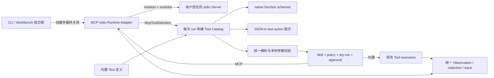

# 设计：stdio MCP + 动态 Tool 注册 + 现有安全链

- 日期：2026-07-17
- 状态：已实施（自动门禁与真实本地验收通过）
- 上位方向：[Project vNext 总方向](../../project-vnext-direction.md)
- 实施计划：[stdio MCP + 动态 Tool 注册实现计划](../plans/2026-07-17-stdio-mcp-dynamic-tools.md)
- 性质：开放扩展内核第一切片的已确认实现 spec

## 一句话目标

让用户显式信任的本地 stdio MCP Server 能把 Tool 动态注册进一次 Agent run，并与内置 Tool 共用同一份 Tool Catalog、参数校验、Skill 限制、policy、approval、observation、redaction 和 trace；本期不建设 MCP 商店、管理 UI 或远程 transport。

## 当前事实与问题

项目已经有可复用的安全和运行底座，但 Tool 定义目前仍是静态的：

- `core/actions.py` 用 `ARGS_MODELS` 识别名称并校验参数；未知名称直接是 `UNKNOWN_TOOL`；
- `core/tool_schemas.py` 从同一批静态名称生成 native function schema；
- `core/loop.py` 的 JSON-in-text 提示、执行分派和 `SUPPORTED_TOOL_ACTIONS` 也只认识内置 Tool；
- `policy/approvals.py` 只给静态名称分类，动态名称会被当成 policy 不支持；
- 默认 `code-dev` Skill 精确列出允许的 Tool，新 MCP Tool 即使注册成功也会被 Skill 拒绝；
- Workbench approval、Run Event、observation feedback、预算截断和 `tool_calls.jsonl` 已经与具体 Tool 名称基本解耦，可以继续复用；持久化 redaction 也可复用，但必须前移成实时 Observation seam；
- 当前 `AgentConfig` 是扁平 TOML，并会写入 chat session；Workbench 的配置写回也不支持嵌套 table，因此 MCP 启动命令不应塞进主配置。

真正要补的不是第二套执行器，而是一个运行时冻结的 Tool Catalog，以及一个只负责 MCP 协议和进程生命周期的 Adapter。

## 目标

本切片完成后必须同时成立：

1. 没有 MCP 配置时，现有 CLI、ChatSession、Workbench、native/JSON tool calling 的协议与正常任务行为不变；唯一有意的兼容性收紧是 Tool Observation 在进入 RunResult/模型前也会脱敏，不再只保护落盘日志。
2. 用户级 stdio MCP Server 可完成 initialize、分页 `tools/list` 和 `tools/call`。
3. 一次 run 内的内置 Tool 与 MCP Tool 来自同一份不可变 Tool Catalog；native 与 JSON-in-text 两种模型协议看到同一集合。
4. MCP 参数在远端调用和审批前完成本地 JSON Schema 校验。
5. MCP Tool 不绕过 Skill、policy、approval、dry-run、observation、预算、redaction、hook 和 trace。
6. CLI 单次运行、CLI 交互会话及 Workbench 退出或异常时都不遗留 stdio Server 进程。
7. MCP 调用失败可作为现有可恢复 observation 回喂模型，但绝不自动重放可能已产生副作用的调用。

## 非目标

本切片明确不做：

- Streamable HTTP、SSE 或其他远程 MCP transport；
- MCP resources、prompts、sampling、elicitation、roots 或 progress UI；
- Registry、Marketplace、Hub、自动下载、安装、更新、卸载或来源签名；
- Workbench MCP 页面、Settings 表单、健康面板、`/api/mcp/*` 或新的前端组件；
- 项目级 MCP 命令、仓库自动发现、配置热重载或配置写回；
- 持久连接池、跨进程共享、自动重试、自动重启或通用插件框架；
- 根据 MCP annotations 自动判定“低风险”；
- 图片/音频直接交给模型，或为二进制结果新建 artifact store；
- 并行多 Tool 模型调用；Agent 每轮仍只执行一个动作。

## 不可破坏的安全不变量

1. **只有一条执行链。** MCP Adapter 不审批、不发 Run Event、不写独立调用日志；它只发现 Tool、调用远端 Tool、规整协议结果和关闭进程。
2. **stdio Server 不是 WorkspaceSandbox。** Server 进程拥有当前 OS 用户权限，现有路径检查无法约束它内部的文件、网络或子进程访问。
3. **启动授权与调用授权分开。** 用户把命令写入用户级 MCP 配置，代表允许 Agent 启动该进程；每次具体 Tool 调用仍要经过现有 approval。
4. **项目文件不能赋予启动权限。** 克隆的仓库不得通过 `.agent/config.toml` 或仓库内 MCP 文件让 Agent 自动运行命令。
5. **所有 MCP Tool 首期固定为 confirmation-required。** Server 的 annotations 只是不可信提示，不能降低风险等级。
6. **不重放不确定副作用。** timeout、EOF、协议错误或进程退出后不自动重试本次 `tools/call`。
7. **未知仍拒绝。** 公开名冲突、无效 schema、超额 catalog 或运行时不存在的名称均 fail closed，禁止 last-wins。

## 目标架构



这里有两个不同层次的职责：

- **Tool Catalog Module** 是一次 run 的唯一 Tool 事实源，负责描述、查找、schema 派生和参数校验；它不拥有进程。
- **MCP Runtime Adapter** 隔离官方异步 SDK、stdio 子进程、协议类型和关闭逻辑；核心 loop 只看同步 Interface。

生产 Adapter 与测试 Fake Adapter 是这个 seam 的两个真实 Implementation；不再为未来 transport 预建抽象层。

## Module 与 Interface 设计

### 1. MCP Runtime Adapter

新增一个深 Module，首期保持在单文件 `src/agent/mcp_runtime.py`，对核心暴露最小同步 Interface：

```python
class McpToolRuntime(Protocol):
    def discover_tools(self) -> tuple[McpToolDefinition, ...]: ...
    def call_tool(
        self,
        target: McpToolTarget,
        arguments: dict[str, Any],
    ) -> McpCallResult: ...
    def close(self) -> None: ...
```

配套的领域值对象只保留核心需要的信息：

```text
McpToolTarget
  server_id
  remote_name
  snapshot_contract     # 不透明、不可序列化；绑定该次发现的 output validator

McpToolDefinition
  exposed_name
  target
  description
  input_schema
  output_schema (optional)
  input_validator       # 已安全检查并预编译

McpCallResult
  status = ok | tool_error | timeout | failed
  summary
  data                 # 已变为普通、可 JSON 序列化的数据
  diagnostic_details   # 有界；不含原始二进制和环境值
  redaction_replacements
```

约束：

- 构造函数只保存 workspace 与用户配置路径，不读取配置、不启动线程或进程；首次 `discover_tools()` 才读取并校验一次配置、冻结该 Runtime 的配置快照并 lazy start。这样无 MCP 配置时没有副作用，Workbench 配置错误也能进入现有 job error 路径；配置变化仍只在下一次 CLI/Workbench 进程生效。
- SDK 的 async context、session 和子进程始终留在同一个专用事件循环线程；同步核心通过线程安全桥调用，禁止每次请求 `asyncio.run()`。
- `call_tool()` 只接受 catalog 中保存的 `McpToolTarget`，不根据模型提供的字符串重新拼远端路由。Target 是 Runtime 生成的快照 capability；core 只原样传回，不读取、复制或持久化其中的 contract。
- call 层的 Tool 业务失败、timeout 与 transport/protocol failure 由 `McpCallResult.status` 明确区分；discovery/config failure 使用不含 SDK 类型的 `McpRuntimeError(stage, server_id, message)`。
- `close()` 线程安全且幂等；关闭后拒绝新调用。
- Adapter 不导入 approval、Run Event 或 run store，不返回官方 SDK/Pydantic 对象。

### 2. 运行时 Tool Catalog

深化现有 `core/tool_catalog.py`，增加不可变 `ToolDefinition` 与 `ToolCatalog`：

```text
ToolDefinition
  name
  description
  input_schema
  source = builtin | mcp
  risk = terminal | low-risk | confirmation-required
  dry_run = execute | skip
  input_validator
  mcp_target (MCP only)

ToolCatalog
  definitions()
  model_tools()
  resolve(name)
  validate(name, args)
```

每次 `run_once` 开始时：

1. 根据当前 `AgentConfig` 生成内置定义；`web_search_enabled=false` 时仍隐藏 `web_search`。
2. 从借用的 MCP Runtime 取得完整、原子化的 Tool 快照。
3. 校验名称、数量、schema 与冲突后合并并冻结 catalog。
4. 本次 run 的提示、native schemas、action parse、policy、执行分派和 trace 都传同一个 catalog。

现有内置执行器不改造成通用插件框架。`_tool_observation()` 的安全前半段保持一条链，最后只按 `definition.source` 选择“现有内置分派”或 `mcp_runtime.call_tool()`。这是本期最小改动；等未来出现第三类真实 Tool Adapter 再考虑统一 executor Interface。

`TraceRecord` 从同一个 resolved definition 派生 `tool_source`；MCP 再记录 `server_id` 与原始 `remote_name`。run config/summary 最多记录启用的 Server ID 和经过精确脱敏的协商版本，不记录 MCP Server 的启动 command、argv、cwd、环境变量名或值。

### 3. 向后兼容

- `parse_model_action(..., tool_catalog=None)` 的默认值生成纯内置 catalog，保留大量现有直接调用测试和库调用者。
- `run_once(..., mcp_runtime=None)` 在未注入时不读取用户配置、不启动进程；除下述实时 redaction 收紧外，行为与当前版本一致。
- 只有 CLI、Chat 和 Workbench 这些组合根会读取 MCP 配置并注入生产 Runtime；核心 Module 不产生隐藏进程副作用。
- `DRY_RUN_SKIPPED_TOOLS` 与 `SUPPORTED_TOOL_ACTIONS` 继续作为从纯内置 catalog 派生的兼容导出；新执行路径不再把它们当动态 Tool 事实源。
- 安全例外必须明示：`RunResult.observation`、Chat final、模型 feedback 以及结构化 action/approval/observation event 中命中 redaction 规则的值会变为 `[REDACTED]`；内部 action args 仍保留执行所需原值。既有 `model_stream_chunk` 是 Provider 原始预览，本切片不为了跨 chunk secret 检测重做流式缓冲，不能把它宣称为已脱敏或持久化审计面。现有“runtime result 保留 secret”的 characterization 测试要改成新契约。

## 依赖与协议基线

采用官方 Python SDK，不手写 JSON-RPC、stdio framing 或 Windows 进程树清理：

```toml
dependencies = [
  "mcp>=1.28.1,<2",
  "jsonschema>=4.20,<5",
]
```

- 固定稳定的 v1.x 主版本，不采用仍在预发布的 v2；不安装不需要的 `[cli]` extra。
- `jsonschema` 是本项目直接使用的依赖，用于 discovery 边界的 schema 安全检查、预编译 snapshot-bound output validator，以及审批前验证 MCP 参数；不能只依赖 Server 或 SDK 的可变 session cache 事后报错。
- SDK 会提高实际 Pydantic 下限并引入 AnyIO、HTTPX、Starlette/Uvicorn 及 Windows 支持依赖；实现计划必须先跑完整回归，不能把依赖成本写成“零”。
- 协议版本由 SDK initialize 协商，不硬编码伪造版本；本 spec 以当前稳定规范 2025-11-25 的 Tool 和 stdio 语义为基线。

官方依据：

- [Python SDK README 与版本线](https://github.com/modelcontextprotocol/python-sdk/blob/main/README.md)
- [Python SDK v1.28.1](https://github.com/modelcontextprotocol/python-sdk/releases/tag/v1.28.1)
- [MCP 生命周期](https://modelcontextprotocol.io/specification/2025-11-25/basic/lifecycle)
- [MCP stdio transport](https://modelcontextprotocol.io/specification/2025-11-25/basic/transports#stdio)
- [MCP Tools](https://modelcontextprotocol.io/specification/2025-11-25/server/tools)

## 配置与信任边界

### 配置位置

首期只读取用户级 `~/.agent/mcp.toml`，不改 `AgentConfig`，不读取项目内同名文件，也不自动创建或修改该文件。读取前解析配置文件与父目录的 real path；若文件或父目录通过 symlink/junction 落入当前 workspace，立即拒绝，项目文件不能借用户路径重定向取得启动权限。用户把整个 `~/.agent` 显式迁移到 workspace 之外的其他用户目录不在本期禁止范围。

原因：

- MCP command 是可执行代码，不应由仓库配置静默赋权；
- 嵌套 server table 不适合当前扁平 `AgentConfig` 和 Workbench TOML 写回；
- command、argv 和环境变量名不应复制进每个 chat session；
- 独立文件使后续管理生命周期可以演进，而不污染当前配置契约。

### 首期文件格式

```toml
[servers.local_files]
command = "mcp-server-files"
args = ["{workspace}"]
pass_env = []

[servers.github]
command = "github-mcp-server"
args = ["stdio"]
pass_env = ["GITHUB_TOKEN"]
```

固定语义：

- `servers` 下每个 table 就是一台已启用 Server；首期不增加 `enabled` 或 profile。
- Server ID 只允许 ASCII 字母、数字、`_`、`-`，且必须唯一。
- 只接受 `command`、`args`、`pass_env`、可选 `cwd`；未知字段、错误类型、空 command 立即报 `ConfigError`。
- `command` 是一个 executable，`args` 是逐项 argv；两者都拒绝 OS 进程参数无法表示的 NUL。始终 `shell=False`，禁止 shell 字符串拼接和自行加引号。
- cwd 默认固定为用户拥有的 `~/.agent` 配置目录，避免 Python/Node 等可信 executable 因当前目录模块搜索而被仓库里的同名文件劫持。`args` 中只有完整 token `{workspace}` 会替换为已解析的 workspace 绝对路径；不做字符串内插值或环境变量展开。
- 可选 `cwd` 只接受 `"config"`（默认）或 `"workspace"`。后者是用户在全局文件中对该 Server 的额外显式信任，README 必须警告：Server 启动阶段就可能读取/执行仓库内 import、配置或启动脚本，发生在具体 Tool approval 之前。首期不接受任意 cwd 路径。
- 相对路径型 command 被拒绝；绝对路径必须存在，代表用户对该精确路径的显式信任。Windows 的裸命令和显式绝对 command 都只接受原生 `.exe/.com`：`.cmd/.bat` 即使 `shell=False` 仍可能被系统命令解释器解析且 Python 不负责参数转义，`.ps1` 也不是可直接交给 `CreateProcess` 的 executable。脚本型 Server 必须显式配置可信解释器 executable，并把脚本路径作为 argv；不得改用 `shell=True` 绕过。
- 裸命令必须先由本项目解析为绝对路径，再交给 SDK。解析器只枚举进程启动时可信 `PATH` 中的绝对目录，排除空项、`.` 和相对项；每个目录项先 canonicalize，并用文件身份统一普通、`\\?\`、UNC、symlink/junction 等别名，real path 落入当前 workspace/其子目录的 alias 也整体丢弃。快照只保留不含平台 PATH 分隔符的 canonical absolute directories；启用 Server 时若净化结果为空则 fail closed，不能把空 PATH 交给子进程重新解释成 cwd。Windows 只从启动快照的 `PATHEXT` 保留 `.exe/.com`，候选文件 `resolve()` 后再次校验真实目标仍是原生 executable 且不在 workspace 内。禁止直接调用可能把 cwd 放在 PATH 前面的 `shutil.which(command)`。同一份 canonical 目录列表与规范化 `PATHEXT` 还要形成子进程专用快照，不能只用于解析顶层 command。裸命令若只在 workspace 中存在必须失败，用户确实要信任它时只能在全局配置写原生 executable 的绝对路径。
- 不支持明文 `env`。`pass_env` 只写环境变量名称，名称必须合法；`PATH`/`PATHEXT` 是 Runtime 保留项，不能通过 `pass_env` 覆盖，Windows 上按环境变量的大小写不敏感语义比较；声明但不存在的变量导致该 Server 启动失败并给出变量名，错误中绝不包含值。
- 子进程环境以 SDK 的安全默认集合为底，加入允许的 `pass_env` 指定值，最后显式覆盖为上一步净化后的 `PATH`/`PATHEXT`；禁止传整个 `os.environ` 或把原始 PATH 合并回来。这不能约束恶意 Server 主动指定绝对路径，也不取消用户显式选择 `cwd="workspace"` 的额外风险，但能在默认 config cwd 下阻止 initialize 阶段因 workspace venv、`node_modules/.bin` 或仓库目录污染 PATH 而误执行 shadow helper。
- Runtime 在内存中保留非空 `pass_env` 值，对所有 SDK 派生数据做最长值优先的精确替换。description、版本和错误摘要命中时替换为 `[REDACTED]`；Tool name、input/output schema 命中时 discovery 整体 fail closed，不能通过改写路由或 schema 继续运行；Tool 结果命中时替换并累计 `redaction_replacements`。任何 SDK 派生数据离开 Adapter 前都完成该处理，再走现有通用 redaction，原值绝不进入模型、event 或持久化。SDK 自己发出的协议校验日志也属于这个边界，不能绕过 Adapter 直接进入 root logger。
- README 必须要求 secret 只通过 `pass_env` 传递，不写进 `command` 或 `args`；后两者可能出现在 OS 进程列表中，Runtime 即使不记录也无法替用户隐藏。
- 不持久化 MCP Server 的启动 command、启动 argv、cwd、环境变量名/值或 stderr 到 session、run summary 或 tool trace；trace 只记录 Server ID、经过精确脱敏的协议/版本、公开 Tool 名和远端 Tool 名。现有 `action.action.args` 仍按既有格式保存 Tool 调用参数的脱敏副本，不能与 Server 启动 argv 混为一谈。

首期硬上限：最多 8 台 Server、合计 64 个 MCP Tool、按紧凑 JSON UTF-8 计算的单 Tool schema 最大 64 KiB、全部 MCP schema 合计最大 512 KiB、公开 description 最大 1,000 字符；最终发送给模型的 MCP name/description/input schema 紧凑 payload 另设 128 KiB 上限。Server/Tool/schema/model payload 超限都在模型调用前明确失败，不静默裁剪 schema 或丢 Tool；description 可以带明确截断标记缩到 1,000 字符。

## stdio 生命周期

### 初始化与发现

每台 Server 严格按以下顺序：

1. `stdio_client(StdioServerParameters(...))`
2. `ClientSession(read, write)`
3. `await session.initialize()`
4. 校验协商结果包含 `tools` capability
5. 分页调用 `tools/list`，直到 `nextCursor` 为空

分页必须：

- 使用 SDK 当前的具名 `params` API；
- 记录已见 cursor，重复 cursor 立即终止并报协议错误；
- 先完成所有页面、全部本地校验，再原子发布快照；
- 任一已配置 Server 失败时，本次 catalog 构建整体失败，禁止悄悄使用部分 Server。

`notifications/tools/list_changed` 只把 Runtime 标记为 dirty。通知 handler 不能在 SDK receive loop 内直接等待 `list_tools()`；下一次 `run_once` 构建 catalog 时再刷新。每个已发布 Target 自带原快照的 output contract；刷新即使更新 SDK 内部 cache，也不能改变旧 Target 的校验语义。已经开始的 run 永远使用原快照，不热替换模型 schema。

首次 discovery 的任何配置、初始化、transport 或本地 metadata 校验失败都关闭已启动 Server。已经 `ready` 后的 refresh 要区分失败类型：transport/protocol/timeout 仍关闭并标 failed；新列表仅在 Runtime 边界负责的 per-Tool object/dialect/ref/64 KiB 等 metadata 安全检查失败时，不发布新快照、不中断健康 session，而是在 `ready` 状态旁保存有界 refresh error。触发刷新及之后的新 run 都在模型调用前看到该错误；旧快照只继续服务已经开始的 run。只有后续 `list_changed` 触发并成功刷新或进程重启才清除该错误，不自动轮询重试。跨 Tool 总预算和名称冲突仍由 Catalog 对当前 Runtime-valid snapshot fail closed，不回写 Runtime 状态。

### 生命周期所有权

MCP Runtime 由最外层组合根拥有：

| 入口 | Runtime 生命周期 | 必须覆盖的退出路径 |
| --- | --- | --- |
| `agent run` | 单次命令 | 成功、Provider 错误、run 错误、Ctrl+C |
| `agent chat` | 整个交互会话，多 turn 复用 | `/exit`、EOF、Ctrl+C、异常 |
| Workbench | `serve_workbench` 进程，多 job 复用 | 正常关闭、KeyboardInterrupt、启动失败 |

- `ChatSession`、`ChatRuntime` 和 `run_once` 只借用，不负责关闭。
- `ChatRuntime` 的公共 Interface 继续只有 `start/poll/decide`；不为了 MCP 增加公开 `close()`。
- `serve_workbench` 的所有权范围从 Runtime 创建后覆盖 handler 创建、HTTP bind、browser timer 与 `serve_forever()`；关闭使用嵌套 `try/finally`，先尝试 `server_close()`，即使它失败也必须关闭 MCP Runtime。
- `/api/chat/turn` 兼容路径也注入同一个 Runtime，不新建第二组进程。
- `ChatRuntime` discovery/config failure 继续进入既有 job `error` 终态；同步 `/api/chat/turn` 对 config stage 返回既有 JSON 400，对 initialize/discovery failure 返回既有 JSON 502，不能断开连接或暴露 traceback，且两条路径都不得先调用模型。
- 配置变化在下一次 CLI 进程或 Workbench 重启后生效；不做热重载。

### 异步桥、并发与关闭

- 一个 Runtime 拥有一个专用 async 事件循环线程；每台 Server 再有一个长驻 owner coroutine/task，由它在同一个 task 内进入、使用并退出 `stdio_client` 与 `ClientSession` context manager。
- 同步调用只把 `discover/call/close` 命令与 completion future 投递到 owner queue。禁止用多个独立 `portal.call()` 或 `run_coroutine_threadsafe()` 分别 enter/exit async context；只在同一线程还不够，AnyIO cancel scope 还要求同一 owner task。
- Runtime 用一个 stdlib lock/condition 保护 `new → starting → ready/failed → closing/closed`；`ready` 可附带 last-good snapshot 和有界 refresh error，但不是另一套重连状态机。并发首次 `discover_tools()` 必须 single-flight：只创建一条 loop thread 和每 Server 一个 owner，其他调用者等待同一结果；`close()` 与 starting/discovery 竞争时不得发布 ready 或留下进程。
- 每台 Server 的 owner queue 天然串行；不同 Server 的 owner task 可并发。Workbench 多 job 对同一 Server 排队，不建立连接池。
- discovery 有非空总 timeout，首期固定每台 15 秒；排队 timeout 和已开始的 MCP request timeout 分别固定 60 秒；关闭宽限固定 5 秒。首期不开放配置。
- 每个 call command 的状态由同一把锁保护：`queued` 只能原子转为 `running` 或 `canceled`，`running` 再转为 `finished`。排队 timeout 只有成功把 `queued` 原子改为 `canceled` 才能报告“未调用”；owner 只有成功把 `queued` 原子改为 `running` 才能发 request。若 timeout 观察到已经 `running`，必须按 request timeout 处理并关闭 session，禁止返回“调用数 0”后仍发生副作用。
- 只有 owner 已确认开始远端 request 后发生的 timeout，才关闭该 session 并标为 failed；不能因为第二个 job 等待超时而杀掉第一个 job 的调用。
- `close()` 退出 SDK 的两个 async context manager；SDK 负责 stdin 关闭、等待、terminate/kill，并在 Windows 使用 Job Object 清理子孙进程。
- `close()` 必须让 owner task 进入自己的 `finally`；活跃 MCP request 被取消，所有排队/活跃 MCP completion future 都以明确的 closed/failed 结果完成。首期不建设通用 Chat job 取消，不声称关闭任意 Provider 或 approval wait worker。
- 首期不采集 Server stderr：给 SDK 一个 Runtime 自己打开并关闭的 `os.devnull` 文本句柄，避免原文泄漏、PIPE 填满和跨平台 drain 复杂度。Runtime 还要覆盖 SDK 1.28.1 的全部已知协议校验日志路径：既包括 `mcp.client.stdio` 的畸形 stdout，也包括 `mcp.shared.session` 通过 root logging 输出的无效 ServerRequest/ServerNotification 与原消息。owner thread 在进入 SDK context 前把同一个窄 `logging.Filter` 实例安装到 root logger 与 `mcp.client.stdio` logger；只有同时命中 owner thread ID 和已安装 MCP package source path/明确 MCP logger 的 record 才被抑制或改写，并清空 `args/exc_info/stack_info`，其他 record 原样通过。owner `finally` 必须移除该实例，即使初始化或 close 失败也不残留；不能用全局禁用 logging 的方式掩盖问题。自有 diagnostic 只保留 stage、Server ID 和经过精确脱敏的有界摘要。
- timeout 后该 session 必须被关闭并标为 failed，确保后台请求不会继续无限运行；当前 Runtime 内不自动重新初始化。用户重新启动 CLI/Workbench 后才重试。
- `CallToolResult.isError=true` 是 Tool 业务失败，不把健康 session 标为 failed；transport、EOF、进程退出和协议损坏才标记 failed。
- 当前 run 已冻结的 catalog 可以把一次 transport failure 作为 observation 回喂模型；之后的新 run 若发现任一已配置 Server 处于 failed，必须在模型调用前明确失败并提示重启，不能用旧 schema 假装健康或悄悄降级成部分 catalog。
- 当前 run 内再次选择同一 failed Server 时只返回有界 `TOOL_FAILED`，远端调用计数不增加；仍可选择其他已健康 Server 或内置 Tool 完成本轮。

## 动态名称、schema 与模型可见性

### 公开名称

MCP 只保证名称在单台 Server 内唯一，Provider 对 function name 又通常有更窄限制，因此模型可见名固定为：

```text
mcp__<server_id>__<normalized_remote_name>
```

规则：

- 只保留 ASCII 字母、数字、`_`、`-`，其他字符替换为 `_`；
- 最大 64 字符；超长时截断并追加 `_` 与 8 位 SHA-256 短摘要；
- route table 始终保留原始 `server_id` 和 `remote_name`；
- 规范化后冲突、与内置名称冲突或重复公开名都使 catalog 构建失败；禁止自动覆盖或依赖 Server 返回顺序；
- trace 和 approval reason 同时给出公开名、Server ID、原始 Tool 名，模型不能自行伪造路由。

### schema 校验

- `inputSchema` 必须是 JSON object，并按 JSON Schema 2020-12 检查自身合法性；`$schema` 只能缺省或明确为受支持的 2020-12 dialect，未知 dialect fail closed。
- 允许本地 `#...` 引用；首期递归拒绝任何可能触发网络/文件读取的非 fragment `$ref` / `$dynamicRef`，validator 不安装远程 retrieval handler。
- 可选 `outputSchema` 采用相同的 object、dialect、引用和大小安全检查；schema 预算按 input + output 合计。discovery 在发布前预编译 input/output validator，且不安装远程 retrieval handler。
- MCP args 保持模型给出的 JSON object，不应用 schema 中仅作 annotation 的 `default`。
- 验证失败映射为现有 `INVALID_ARGUMENT`，进入 repair loop；必须发生在 policy、approval 和远端调用之前。
- 内置 Tool 继续使用现有 Pydantic model；MCP input 使用 Runtime 在 discovery 边界预编译并随定义发布的 `jsonschema` validator。两者都通过 `ToolCatalog.validate()` 暴露。
- MCP call 使用官方低层 typed request API（`ClientSession.send_request` + `CallToolRequest`/`CallToolResult`），不手写 JSON-RPC，但明确绕开 `ClientSession.call_tool()` 的 session 级可变 output-schema cache。Adapter 收到结果后只使用 `McpToolTarget.snapshot_contract` 中已安全检查、预编译的 output validator；不匹配时只生成 stage、JSON path 和 validator keyword 等有界诊断，不 stringify `ValidationError`、instance 或 schema fragment，再映射为 `failed`、关闭该 Server，并最终产生可恢复的 `TOOL_FAILED`，原始 structured data 不得离开 Adapter。

### native 与 JSON-in-text

- native 模式：从同一 `ToolDefinition` 派生 function name、description 和 parameters；Provider Adapter 已能透传任意 schema，不增加 MCP 特判。
- JSON-in-text 模式：系统协议消息从同一 catalog 列出 MCP 公开名、受限 description 和紧凑 input schema；不能只列名称，否则默认 `native_tools=false` 下动态 Tool 实际不可用。
- 两种模式都增加系统级规则：MCP description/schema 是用户所选外部 Server 提供的不可信元数据，不能修改系统、安全或审批规则。
- description 可截断，schema 不可截断；超出 schema 预算或 128 KiB 最终模型 payload 预算时整个 catalog 构建在模型调用前失败。native 与 JSON-in-text 对相同 catalog 使用同一预算结果。

## Skill、policy、dry-run 与 approval

执行顺序固定为：

```text
parse envelope
→ catalog resolve + 本地参数校验
→ before_tool hook
→ policy
→ Skill allowed_tools
→ dry-run
→ approval
→ builtin executor 或 MCP call
→ Observation 归一化
→ 共享实时 redaction + budget 截断
→ observation event + after_tool hook
→ 不可信 observation 回喂模型
→ run 结束时按现有路径将 action/observation/trace 脱敏持久化
```

具体规则：

- 所有 MCP `ToolDefinition.risk` 固定为 `confirmation-required`；忽略 annotations 中的 read-only/destructive 等提示对 policy 的影响。
- approval reason 必须同时给出公开名、Server ID、原始 Tool 名，并明确：该外部进程拥有当前 OS 权限，workspace 路径检查不能约束其文件、网络和子进程访问；approval event 与 trace 使用同一个 reason。
- `approval=risky-confirm` 与 `approval=always` 都要求批准；`approval=never` 不得调用。
- `sandbox=read-only` 不得调用任何 MCP Tool。
- `dry_run=true` 不得调用任何 MCP Tool。
- `read-only`、`dry_run` 和 `approval=never` 约束的是 `tools/call`，不是 discovery：为构建动态 catalog，用户已在全局配置中启用的 Server 仍可能被启动并执行 initialize/list。README 必须明确这一区别；若用户连进程都不信任，就不应把它写入 `mcp.toml`。
- 默认 `code-dev` Skill 增加保留项 `mcp:*`，否则默认 Skill 会让功能不可用；`doc-research` 不自动增加。
- Skill `allowed_tools` 支持精确公开名或保留项 `mcp:*`。该 wildcard 只匹配 `source=mcp` 的定义，不能匹配内置 Tool，也不能让未知名称绕过 catalog。
- 未授权 Skill 仍返回 `POLICY_DENIED`；Skill 许可也不能覆盖 read-only、approval 或未知 Tool 拒绝。
- dry-run、拒绝、审批超时及 Skill/policy 拒绝时，Fake Runtime 的远端调用计数必须为 0。
- 批准后每个 action 只调用一次，沿用现有事件次序：`tool_start → approval_required → approval_granted/approval_denied → observation`。

当前仓库的通用 redaction 只在写 `tool_calls.jsonl` 和 summary 时执行，不能据此声称模型回喂已经安全。本切片必须把它深化为共享 seam：所有 Tool Observation 在归一化后、预算把结构压成 excerpt 前，先对 `summary/data/error` 执行现有结构化/模式脱敏；结构化 action/approval event 的 `message/args` 也先走同一 helper。脱敏后的对象才可进入 event、RunResult、模型 feedback 或持久化。Runtime 还要在 discovery/call/error 出口更早做 `pass_env` 精确处理，并把 `McpCallResult.redaction_replacements` 合并进 Observation 的实时替换计数。持久化层继续累加实时 count 与最后一次防御性 redaction count，使 `redaction.applied` 证据保持真实，而不是因二次脱敏得到 0。该改动同时保护内置 Tool，不只给 MCP 建旁路；`model_stream_chunk` 的原始预览例外按向后兼容章节如实记录。

## Tool 结果与错误映射

不能对 SDK 结果直接 `str(result)`。Adapter 必须将 MCP content block 转成普通 JSON 数据：

| MCP 内容 | 首期处理 |
| --- | --- |
| `TextContent` | 保留有界文本 |
| `structuredContent` | 保留 JSON object，继续受 observation 20,000 字符预算约束 |
| `ResourceLink` | 保留 type、URI、name、MIME 等元数据 |
| embedded text resource | 保留有界文本与元数据 |
| image/audio/blob | 不把 base64 写入 prompt、session 或 trace；只保留 MIME、字节数、`omitted=true` |
| 未知未来 block | 保留 type 与 `omitted=true`，不猜内容 |
| `_meta` | 首期不进入模型或持久化数据 |

成功 Observation 的 data 至少包含：

```json
{
  "source": "mcp",
  "server_id": "github",
  "remote_tool": "search_issues",
  "content": [],
  "structured_content": {}
}
```

映射规则：

| 情况 | 现有语义 | 是否继续本轮恢复循环 |
| --- | --- | --- |
| 模型参数不符合本地 `inputSchema` | `INVALID_ARGUMENT` | 是，走 repair |
| `CallToolResult.isError=true` | `TOOL_FAILED`，把有界可操作文本回喂模型 | 是 |
| owner queue 排队 timeout | `TIMEOUT` | 是；命令取消且未调用，Server 保持健康 |
| 已开始的 MCP request timeout | `TIMEOUT` | 是；关闭并把该 Server 标为 failed |
| EOF、进程退出、transport/protocol 错误 | `TOOL_FAILED` | 是，但该 Server 标为 failed |
| snapshot output schema 或结果结构错误 | `TOOL_FAILED` | 是；Server 标为 failed，不把原始对象泄漏给模型 |
| discovery/config/initialize 失败 | run 启动错误，模型尚未调用 | 否；CLI 退出 1，Workbench 异步 job 发 error 后结束；同步 `/api/chat/turn` 按 config 400、initialize/discovery 502 返回 |

所有 summary、data 和 diagnostic details 在进入 event、RunResult、模型 feedback、trace 或 session 前都经过共享实时 redaction。由于当前预算不会截断 `error.details`，MCP diagnostic details 必须在 Adapter 内先限制到 4 KiB，且不得包含环境值、Server stderr、SDK 原始 payload 或原始二进制。Adapter 的精确替换次数必须随 `McpCallResult` 传出并进入现有 redaction 审计。

## CLI、Chat 与 Workbench 集成

### CLI

- `agent run` 在调用 `run_once` 外创建 Runtime，并在唯一 `finally` 关闭。
- `agent chat` 在 REPL 外创建一次并跨 turn 复用，在所有退出分支关闭。
- 本期不新增 `agent mcp` 命令；配置管理和专用 doctor 属于下一阶段“可管理生态”。
- 现有 `agent tools list` 继续表示内置 Tool，不为列动态 Tool 隐式启动外部进程；README 必须写清这一点。

### ChatSession

- 构造函数新增可选借用依赖 `mcp_runtime`，`run_turn` 原样传给 `run_once`。
- session JSON 仍只保存 `AgentConfig` 和对话，不保存 Runtime、MCP Server 启动 command/argv 或环境变量名。

### Workbench

- `serve_workbench` 创建并拥有一个 Runtime；`ChatRuntime` 与兼容 `/api/chat/turn` 路径借用同一实例。
- `ChatRuntime` constructor 增可选注入，但 `start/poll/decide` 公共 Interface 不变。
- SSE event type、HTTP URL、请求/响应结构和前端代码不变；既有 action/approval 字段结构保留，但命中规则的值会实时脱敏，MCP approval reason 会补足远端身份与 OS 权限告警。
- MCP discovery 失败表现为当前 chat job 的既有 `error` 终态；不能返回半个 catalog 后继续调用模型。
- `/api/chat/turn` 把同一个 Runtime 传给 `build_chat_turn_payload`；config stage 使用现有 JSON 400，initialize/discovery stage 使用现有 JSON 502。两种错误都必须在模型调用前返回且不泄漏 SDK 类型、stderr 或 traceback。

## 预计文件范围

实现计划应以以下范围为上限，发现真实调用链需要相邻小改动时再在 plan 中注明：

### 新增

- `src/agent/mcp_runtime.py`：配置解析、官方 SDK Adapter、同步桥、发现/调用/关闭和结果规整。
- `tests/test_mcp_runtime.py`：协议、配置、生命周期和真实本地 stdio fixture。
- `tests/core/test_loop_mcp.py`：Fake Adapter 贯穿统一安全链。
- `tests/fixtures/mcp_stdio_server.py`：无网络、可控的本地协议 fixture。

### 修改

- `pyproject.toml`：官方 SDK 与直接使用的 jsonschema 依赖。
- `src/agent/core/tool_catalog.py`：运行时 ToolDefinition/Catalog。
- `src/agent/core/tool_schemas.py`：从 catalog 派生 native schemas。
- `src/agent/core/actions.py`：可选 catalog 解析与动态参数校验。
- `src/agent/core/loop.py`：每 run 冻结 catalog，JSON/native 共用，安全链末端接 MCP。
- `src/agent/core/redaction.py`：新增可复用的实时 Observation 脱敏，并保留替换计数。
- `src/agent/policy/approvals.py`：按 resolved risk 分类，MCP 固定 confirmation-required。
- `src/agent/core/chat.py`：借用 Runtime 并保持 session 持久化不变。
- `src/agent/web/chat_runtime.py`、`src/agent/web/chats.py`、`src/agent/web/server.py`：组合根所有权与内部注入，不改 HTTP Interface。
- `src/agent/cli.py`：run/chat 生命周期所有权。
- `src/agent/builtin_skills/code-dev/SKILL.md`：显式加入 `mcp:*`。
- `README.md`：用户级配置、安全含义、限制和故障行为。
- `docs/project-vnext-direction.md`、`docs/roadmap-progress.md`、`CHANGELOG.md`：只在全部门禁通过后更新真实完成状态。
- 对应现有 config/chat/CLI/Web/UI/tool schema/policy 测试的最小回归更新。

### 不应修改

- `src/agent/llm/openai_compat.py` 与其他 Provider Adapter；
- 内置 filesystem/documents/git/shell/web executor；
- Workbench 静态前端资产；
- run store 格式或另建 MCP 日志；
- 主 `AgentConfig` 与 Workbench Settings 写回协议。

## 测试设计

### 1. MCP Runtime 契约测试

- 无文件返回空配置且不启动线程/进程。
- 合法 table；未知字段、错误类型、空 command、非法 Server ID、非法或缺失 `pass_env`、非法 `cwd`。
- 项目目录里的 `mcp.toml` 永不加载；用户配置文件或其父目录通过 symlink/junction 落入 workspace 时拒绝。
- workspace 中投放与裸 command 同名的 `.exe/.com` 不会被解析；过滤后的可信 PATH 解析结果必须是绝对路径，只有显式绝对 command 才能选择 workspace 内的原生 executable。Windows 的 `.cmd/.bat/.ps1` 无论裸命令还是显式绝对路径都拒绝，脚本 fixture 使用显式原生解释器。
- 默认 config cwd 下，workspace 内 Python/Node 同名模块不能劫持 Server 启动；`{workspace}` 只按完整 argv token 展开；`cwd="workspace"` 必须是全局显式配置且 README 有启动前风险警告。
- 子进程只收到 SDK 安全环境和显式 `pass_env`；声明但不存在的环境变量在进程启动前失败，错误只含变量名。Server 在 initialize/list 的 name/description/schema/version/error 中回显环境值时按既定 replace/fail-closed 规则处理。
- 本地 fixture 完成 initialize、capability、分页 list、call、`isError`、list_changed。
- 重复 cursor、无 tools capability、schema 非 object、外部 `$ref`/`$dynamicRef`、名称冲突和各预算上限均 fail closed。
- 两个线程并发首次 discover 只启动一套 Server；discover 与 close 竞争不发布 ready、不遗留进程。
- 首次 metadata 校验失败关闭 Server；ready 后 refresh 的 Runtime-owned per-Tool metadata 安全检查失败不发布 S2、不关闭健康 session，新 run fail closed，已开始的 S1 run 仍可调用；refresh transport failure 仍关闭。Catalog-owned 总预算/名称冲突另在当前 snapshot 上失败。
- 初始化 timeout、request timeout、EOF、异常退出不自动重试；barrier 控制的 cancel-vs-start 边界中，queue timeout 只有 cancel 胜出时调用计数才为 0，running 胜出则按 request timeout 关闭；正常与异常 close 均无遗留进程。
- 同 Server 并发调用串行；不同 Server 可独立推进；close 幂等。
- Server stderr 进入 `os.devnull`；高流量 stderr、畸形 stdout、合法 JSON-RPC 外壳中的无效 ServerRequest/ServerNotification 均不死锁，`capsys/caplog` 不出现 secret、ValidationError instance 或 SDK 原始 payload。测试同时证明 owner thread 的非 SDK 应用日志及其他线程日志不被吞掉，close 后 filter 已恢复。Windows fixture 至少覆盖“原生解释器 executable + fixture 脚本 argv”，并验证子进程树清理。
- 子进程环境最后显式覆盖净化后的非空 PATH/PATHEXT；round-trip 后每项仍为 canonical absolute directory，不能由目录名中的 PATH 分隔符拆出相对项。默认 config cwd fixture 在 initialize 阶段调用同名 helper 时，workspace venv、`node_modules/.bin`、`\\?\`/junction/symlink PATH alias 或仓库 shadow 的调用计数必须为 0；`cwd="workspace"` 的已声明风险另做 characterization。

### 2. Tool Catalog 与 loop 集成

- 纯内置 catalog 与当前名称、风险、schema 和 web_search 过滤一致。
- native 与 JSON-in-text 都看到同一 MCP 公开名和 input schema。
- native 与 JSON-in-text 的最终 MCP model payload 都受 128 KiB 上限约束，边界内可用、超限在模型调用前失败。
- 非法 args 在 approval 和 `call_tool` 前得到 `INVALID_ARGUMENT`。
- 精确 Skill 名称、`mcp:*`、未授权 Skill 三条路径。
- risky-confirm/always 要审批，approval event 与 trace reason 同时包含公开名、Server ID、原始 Tool 名和 OS 权限警告；never/read-only/dry-run 可以 discovery，但绝不发出 `tools/call`。
- 拒绝、审批超时、hook 阻断时远端调用次数为 0；批准后恰好 1。
- 成功、`isError`、TIMEOUT、transport failure、snapshot output validation failure 都转为现有 Observation 并受错误预算约束；output failure 的原始 structured data 不离开 Adapter。
- barrier 控制 Run A 冻结 S1、Run B dirty refresh 到被拒绝的 S2（含外部 `$ref`）：A 的调用仍只按 S1 snapshot contract 校验，网络/文件 retrieval 次数为 0；SDK session cache 的变化不得影响结果。
- MCP 结果继续经过 20,000 字符 data 截断、不可信 observation 包装和 redaction。
- MCP 与内置 Observation 在 event、RunResult 和模型 feedback 前都已脱敏；`pass_env` 值即使出现在普通文本字段也不会离开 Adapter。
- 实时脱敏后，持久化的 `redaction.applied` 与 replacement count 仍准确，不能因二次处理丢失审计证据。
- `action_parsed/tool_start/approval_*` 的结构化 event message/args 也已脱敏；`model_stream_chunk` 仍按既有原始预览契约处理且不写 durable run log。
- `tool_calls.jsonl` 保持现有格式并增加 source/server/remote tool 证据，无第二份日志；现有 Tool action args 只保存脱敏副本，MCP Server 的启动 command/argv/cwd/pass_env/stderr 不进入记录。
- 现有 builtin Tool 路径仍走原 executor，事件顺序与结果逐字兼容。

### 3. 生命周期和产品路径

- CLI `run` 在成功、Provider 异常、run 异常和 Ctrl+C 后只 close 一次。
- CLI `chat` 在 `/exit`、EOF、Ctrl+C 和异常后只 close 一次，多 turn 不重复启动。
- Workbench 多 job 共用一个 Runtime；Server 调用锁不阻塞其他 Server。
- `serve_workbench` 正常关闭、KeyboardInterrupt、handler/bind/server_close 失败都关闭 MCP Runtime；前一端口 bind 失败的 Runtime 已关闭后 CLI 才尝试下一端口。ChatRuntime 公共方法集合不变，不把本切片扩成通用 Chat job 取消。
- `/api/chat/turn` 与 `/api/chat/start` 都使用同一 Runtime；config/initialize failure 各自走既定 JSON/job error，模型调用数为 0，现有 URL、payload 和 SSE characterizations 全绿。

### 4. 回归与真实验收

实现完成的门禁：

1. 在 `D:\CodexScratch` 的临时 venv/cache 执行 `pip install -e .`、`pip check`、无 MCP 配置的 `python -m agent.cli doctor`，完成后清理；不得用已经装好依赖的当前环境代替干净安装门禁。
2. `python -m pytest -q`
3. `python -m pytest tests/test_mcp_runtime.py tests/core/test_loop_mcp.py -q`
4. `git diff --check`
5. 用本地 fixture 真实跑一次 SDK stdio initialize/list/call/close，不用网络。
6. 预检真实 Provider 的 endpoint、model、key、联网与可能费用；需要产生费用或使用用户凭据时先取得用户确认。
7. `agent run` 在 `native_tools=true` 下完成一次 MCP approval/call/result 并退出，无遗留进程。
8. `agent chat` 在 JSON-in-text fallback 下完成至少两 turn，确认复用同一 Server，随后 `/exit` 并确认进程树消失。
9. 启动真实 Workbench，完成“模型选择 MCP Tool → approval → 调用 → 流式结果 → trace”纵向路径，并确认关闭后无遗留进程。

默认使用 `D:\CodexScratch\agent-mcp-acceptance\home` 作为临时 home 完成第 5、7、8、9 项并在验收后清理；这能验证配置语义和生命周期，但不冒充默认 Windows 用户路径。只有确实需要额外证明 `C:\Users\admin\.agent\mcp.toml` 默认路径时才停下申请用户许可，说明预计不足 2 KiB、具体内容、D 盘替代方案和恢复/删除方式。最终在本 spec 追加一张简短验收证据表，记录命令、Provider/model、结果和进程清理证据，不另建报告文件。

## 完成标准

只有以下条件全部满足，本切片才算完成：

- MCP Tool 与内置 Tool 在模型可见性、解析、policy、approval、observation 和 trace 上只有一个权威 catalog；
- 项目配置不能启动 MCP，用户配置不含明文 secret，子进程不继承无关环境；
- 所有 MCP 调用默认确认，read-only/dry-run/never 不产生 `tools/call`；文档如实说明显式启用的 Server 仍可能为 discovery 启动；
- native 与默认 JSON-in-text 两条真实路径均可用，不要求用户为了 MCP 被迫切换 Provider 协议；
- timeout/崩溃不会自动重放，不会留下进程，错误能被现有 loop 安全恢复；
- CLI、ChatSession、Workbench 与现有测试全部回归，前端和 Provider Interface 无破坏性变化；
- README 如实说明外部进程拥有 OS 权限，本期没有 Marketplace、管理 UI、远程 transport 或低风险自动判定。

## 风险与后续触发条件

| 风险 | 本期缓解 | 何时升级 |
| --- | --- | --- |
| MCP Server 本身有恶意或漏洞 | 仅用户级显式配置、最小环境、每次调用审批、清晰 OS 权限提示 | 出现可信来源/安装需求后做来源、签名、版本和卸载生命周期 |
| 大量 schema 挤占上下文 | Server/Tool/schema 硬上限，run 内冻结 | 真实 Server 经常撞上限时增加 include/exclude 配置与按需 Tool 集 |
| description/schema prompt injection | 标记不可信、限制 description、policy 不读 annotations | 有 eval 证据后做 schema/description 更细的派生与隔离 |
| 长驻 Server 失效 | timeout 后关闭并 fail closed，不自动重放 | 有真实可恢复需求后设计显式 reconnect 与健康状态机 |
| Workbench 并发争用 | 每 Server 串行、不同 Server 独立 | 多 job 使用量证明需要时再做队列可视化或池化 |
| 二进制结果丢失 | 只记录安全元数据 | artifact store 成为真实产品能力后接 image/audio/resource preview |

下一阶段不是立刻做商店，而是在本地调用链稳定后补 **MCP 配置管理、启停、健康诊断与 Skills 完整生命周期**；只有 install → validate → enable → diagnose → update/remove 闭环可靠，Frontend vNext 才接真实 Hub。

## 实施与验收证据（2026-07-18）

| 门禁 / 路径 | Provider / model | 结果 | 进程与存储清理证据 |
| --- | --- | --- | --- |
| D 盘干净 venv：`pip install -e .`、`pip check`、无 MCP 配置的 `agent doctor` | 无 Provider 调用 | editable install、依赖一致性与 doctor 通过 | home/cache/temp/venv 全在 `D:\CodexScratch`，最终统一删除 |
| focused + full pytest | Fake、本地 fixture | `147 passed, 4 skipped`；最终全量 `767 passed, 5 skipped` | fixture close/timeout/竞态测试通过；无测试 Server 残留 |
| SDK initialize → 分页 list → call → close | 官方 MCP SDK 1.28.1 + 本地 fixture | 发现 `echo` / `upper`，调用 `echo` 成功 | fixture PID 210524 已退出 |
| `agent provider smoke openai-compat` | 本地确定性 `openai-compat/local-scripted` | 通过；请求未带 Authorization，不使用用户凭据或付费 endpoint | 本地 HTTP Server 验收结束后关闭 |
| `agent run`，`native_tools=true` | 本地确定性 `openai-compat/local-scripted` | 模型选 MCP → CLI 批准 → call/result → done | fixture PID 191180 已退出 |
| 两轮 `agent chat`，JSON-in-text fallback | 本地确定性 `openai-compat/local-scripted` | 2 turn、2 call，复用同一 Server 后 `/exit` | 仅启动 PID 215548，退出后已消失 |
| Workbench HTTP/SSE | 本地确定性 `openai-compat/local-scripted` | MCP Tool → approval → 流式参数 → observation → final；trace 为 `mcp/local/echo` | fixture PID 212264 已退出；Workbench 经 KeyboardInterrupt/finally 正常退出 |

验收使用 `D:\CodexScratch\agent-mcp-acceptance\home`，没有创建或修改 `C:\Users\admin\.agent\mcp.toml`。本表只证明本地 stdio 动态 Tool 切片，不代表 Marketplace、管理 UI、远程 transport 或完整生态已经完成。
